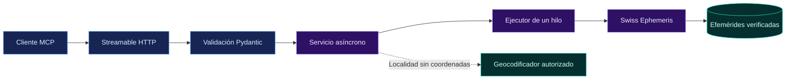

<p align="center">
  
</p>

<h1 align="center">Smart Studio Astrology MCP</h1>

<p align="center">
  El motor numérico independiente de <strong>Carta y Arcano</strong>.<br>
  Posiciones planetarias, cartas, aspectos y efemérides mediante Model Context Protocol.
</p>

<p align="center">
  <a href="https://github.com/vsilva007/smartstudio-astrology-mcp/actions/workflows/ci.yml"></a>
  <a href="pyproject.toml"></a>
  <a href="docs/API.md"></a>
  <a href="LICENSE"></a>
</p>

<p align="center">
  <a href="#inicio-rapido">Inicio rápido</a> ·
  <a href="#herramientas">Herramientas</a> ·
  <a href="#arquitectura">Arquitectura</a> ·
  <a href="#build-y-despliegue">Build y despliegue</a> ·
  <a href="#documentacion">Documentación</a>
</p>

---

## ✨ De un vistazo

| 🪐 Cálculo | 🔎 Trazabilidad | 🔌 Integración |
| :--- | :--- | :--- |
| Swiss Ephemeris y zodiaco tropical | Motor, versión y origen de las efemérides en los resultados | Cinco herramientas MCP con salida estructurada |
| Planetas, nodos, casas y aspectos | Datos y dependencias fijados con hashes | Streamable HTTP, JSON y validación Pydantic |
| Incertidumbre temporal explícita | Oferta de código con manifiesto SHA-256 | Servicio independiente, sin LLM ni historial natal |

> [!IMPORTANT]
> **La fecha y el reloj se usan literalmente como UT convencional.** El servidor no convierte zonas horarias, IANA ni horario de verano. Una hora marcada como «exacta» no equivale a un instante UTC verificado. [Ver la convención temporal](#convencion-temporal).

<a id="inicio-rapido"></a>

## 🚀 Inicio rápido

**Requisitos:** Python 3.11+ y un compilador C cuando PySwissEph no disponga de wheel. La build Docker utiliza la versión exacta fijada en [.python-version](.python-version): **3.12.16**.

### 1. Preparar el proyecto

Desde la raíz del checkout:

```bash
python3 -m pip install uv==0.13.7
uv sync --frozen --python 3.12
uv run python scripts/fetch_ephemeris.py
```

Las efemérides se descargan desde la revisión fijada en el [manifiesto de datos](data/ephemeris-manifest.json) y se verifican por tamaño y SHA-256.

### 2. Arrancar el servidor

```bash
uv run uvicorn smartstudio_mcp.server:create_app \
  --factory \
  --host 127.0.0.1 \
  --port 8000 \
  --no-access-log \
  --no-proxy-headers
```

| Endpoint local | Uso |
| :--- | :--- |
| `http://127.0.0.1:8000/mcp` | Conexión de clientes MCP compatibles con Streamable HTTP |
| `http://127.0.0.1:8000/healthz` | Estado del servicio |
| `http://127.0.0.1:8000/readyz` | Disponibilidad del motor y las efemérides |

### 3. Comprobar la conexión

En otra terminal:

```bash
uv run python scripts/smoke_mcp.py http://127.0.0.1:8000/mcp
```

El smoke test descubre las cinco herramientas y ejecuta un cálculo con coordenadas explícitas.
La configuración opcional se carga desde `.env`; consulta [.env.example](.env.example).

<a id="herramientas"></a>

## 🧰 Cinco herramientas, un contrato

Todas reciben `{"request": {...}}` y devuelven resultados estructurados validados con Pydantic.

| Herramienta | Entrada | Resultado |
| :--- | :--- | :--- |
| `resolve_birthplace` | `PlaceInput` | Candidatos y coordenadas de una localidad; ambigüedad explícita |
| `calculate_natal_chart` | `NatalInput` | Planetas, nodos, ángulos, casas, aspectos e incertidumbre |
| `calculate_transits` | `ReferenceInput` | Posiciones y aspectos mutuos de la referencia temporal solicitada |
| `calculate_aspects` | `AspectInput` | Separaciones angulares y aspectos con orbes configurables |
| `get_ephemeris` | `ReferenceInput` | Posiciones y procedencia del motor y los datos |

### Ejemplo · llamada MCP

```json
{
  "jsonrpc": "2.0",
  "id": 1,
  "method": "tools/call",
  "params": {
    "name": "calculate_natal_chart",
    "arguments": {
      "request": {
        "birth_date": "1985-07-02",
        "birth_time": "08:05",
        "city": "Porto",
        "country": "Portugal",
        "latitude": 41.1579,
        "longitude": -8.6291,
        "time_precision": "exact"
      }
    }
  }
}
```

Las coordenadas explícitas permiten calcular sin geocodificación externa. Si un resultado devuelve `success=false`, no contiene valores astronómicos parciales; las entradas inválidas se rechazan mediante el protocolo MCP.

**Explorar:** [contrato y errores](docs/API.md) · [JSON Schema de las herramientas](docs/tool-schemas.json).

<a id="convencion-temporal"></a>

## 🕰️ Tiempo y precisión

Cada carta declara su convención de cálculo:

| Campo | Valor |
| :--- | :--- |
| `calculation_mode` | `literal_no_timezone` |
| `time_reference` | `supplied_clock_used_as_ut` |
| `precision_status` | `civil_time_not_utc_verified` |

**Sin hora de nacimiento:** se utiliza mediodía declarado, se muestran muestras cada 30 minutos y se omiten casas, ángulos y aspectos natales. Las muestras no representan cotas rigurosas ni una distribución de probabilidad.

<details>
<summary><strong>Ver convenciones astronómicas</strong></summary>

| Parámetro | Convención |
| :--- | :--- |
| Fechas admitidas | Del `1800-01-02` al `2399-12-31`, calendario gregoriano |
| Posiciones | Geocéntricas, tropicales y aparentes, en grados de fecha |
| Motor | Swiss Ephemeris mediante PySwissEph; `FLG_SWIEPH \| FLG_SPEED` |
| Casas | Placidus por defecto; `WholeSign` o `Equal` por selección explícita |
| Nodos | `mean` o `true`, sin sustituciones silenciosas |
| Tránsitos | Aspectos entre los planetas de la referencia solicitada |
| Fallback | No se permite sustituir las efemérides por Moshier/JPL |

La conversión interna UT→TT mediante ΔT de `calc_ut` pertenece al cálculo astronómico; no convierte la hora civil ni resuelve un huso horario. Las casas y los ángulos mantienen el carácter convencional de la hora de entrada.

</details>

<a id="arquitectura"></a>

## 🧭 Arquitectura



Las llamadas al motor se serializan para proteger su estado nativo. ASGI/Uvicorn sirve respuestas JSON sin sesiones; el proxy HTTPS termina TLS fuera del contenedor.

**Geocodificación opcional.** Está desactivada por defecto. Sin coordenadas ni proveedor configurado, se devuelve `GEOCODER_NOT_CONFIGURED`. Para habilitarla, configura un proveedor Nominatim autorizado con `CARTA_GEOCODER=nominatim` y `CARTA_GEOCODER_URL`. El endpoint público de OSMF está bloqueado; el adaptador solo consulta ciudad, país y región, limita las peticiones y no almacena consultas.

<a id="build-y-despliegue"></a>

## 📦 Build y despliegue

### GitHub Actions · tests + build

El [workflow `verify`](.github/workflows/ci.yml) ejecuta:

```text
Push / Pull request / Ejecución manual
                  │
                  ▼
       Python 3.11 · 3.12 · 3.14
       Tests · Ruff · Esquemas · Auditoría
                  │
                  ▼
       Build producción + Build demo
             Python 3.12.16
```

**GitHub Actions solo verifica y construye las imágenes. No ejecuta despliegues ni publica imágenes.**

### Build manual

Con Docker, Compose v2 y Python 3.12.16 instalados, prepara los archivos privados de configuración:

```bash
cp .env.production.example .env.production
cp .env.demo.example .env.demo
chmod 600 .env.production .env.demo

./scripts/build/build.sh --env production
./scripts/build/build.sh --env demo
```

La CLI genera imágenes versionadas y separadas por entorno. El despliegue se realiza manualmente mediante paquetes privados y SSH, con comprobaciones de salud/MCP y recuperación ante fallos.

Consulta la [guía de operación](docs/deployment/README.md) para configurar cada entorno, instalar, verificar aislamiento y hacer rollback.

> [!NOTE]
> La [auditoría del proyecto](legal/AUDIT.md) documenta una revisión pendiente de los datos astronómicos. La activación pública requiere resolver esos bloqueos y completar la configuración de publicación.

## 🧪 Verificación local

```bash
uv run pytest -q
uv run ruff check src tests scripts
uv run ruff format --check src tests scripts
uv run python scripts/export_schemas.py --check
uv run pip-audit -r requirements.lock --require-hashes --disable-pip --no-deps
```

Las evidencias registradas se encuentran en [verificación del servicio](docs/VERIFICATION.md) y [verificación del despliegue](docs/deployment/VERIFICATION.md).

<a id="documentacion"></a>

## 📚 Documentación

| Quiero… | Documento |
| :--- | :--- |
| Integrar las herramientas | [Contrato API](docs/API.md) · [Esquemas JSON](docs/tool-schemas.json) |
| Configurar el servidor | [Variables de desarrollo](.env.example) |
| Construir, instalar o recuperar un entorno | [Guía de despliegue](docs/deployment/README.md) |
| Entender el tratamiento de datos | [Privacidad](docs/PRIVACY.md) |
| Consultar comprobaciones realizadas | [Verificación](docs/VERIFICATION.md) |
| Revisar licencias y dependencias | [Auditoría](legal/AUDIT.md) · [Terceros](legal/THIRD-PARTY.md) |
| Contribuir o revisar cambios | [Contribuciones](CONTRIBUTING.md) · [Changelog](CHANGELOG.md) |

## ⚖️ Licencia y código fuente

Código propio bajo **AGPL-3.0-only**. Se conservan los avisos y condiciones de sus dependencias: [LICENSE](LICENSE), [NOTICE](NOTICE) y [avisos de terceros](legal/THIRD-PARTY.md).

Para generar la oferta de código correspondiente, con las fuentes de las dependencias de ejecución y su manifiesto SHA-256:

```bash
uv run python scripts/build_source.py
```

Produce `artifacts/source.tar.gz` y `artifacts/source.sha256`. El servidor expone `/license`, `/notice`, `/source` y, cuando el archivo está disponible, `/source.tar.gz`.

---

<p align="center">
  <strong>Smart Studio · Carta y Arcano</strong><br>
  Creado por Victor Silva
</p>
